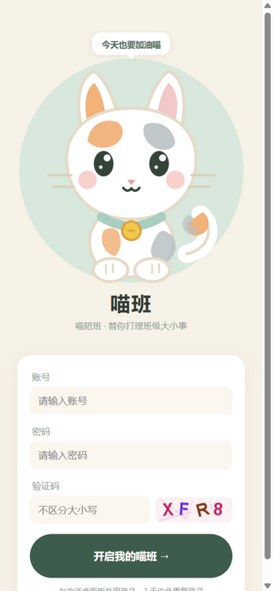
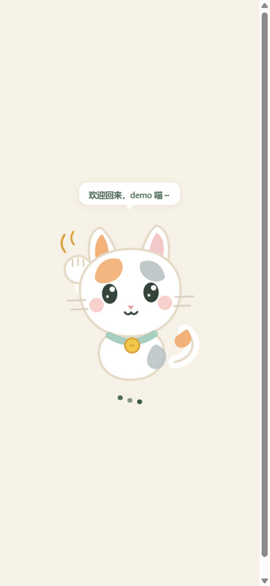
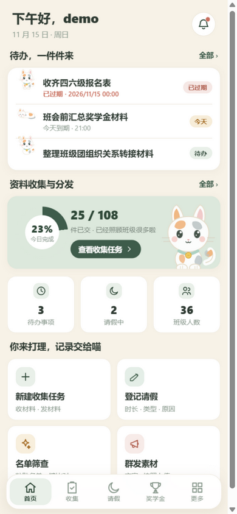
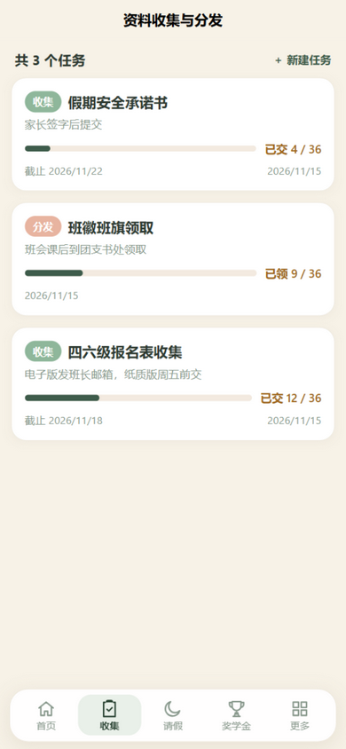
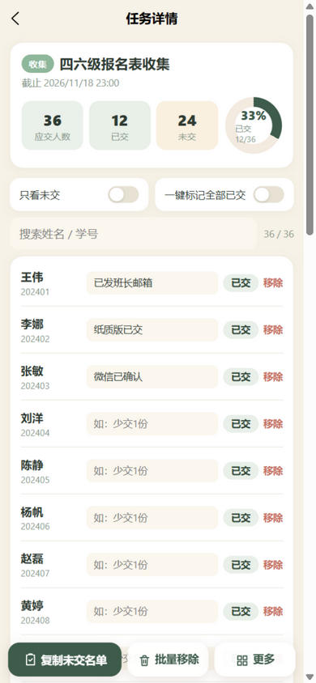
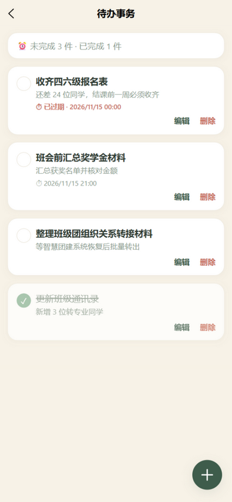
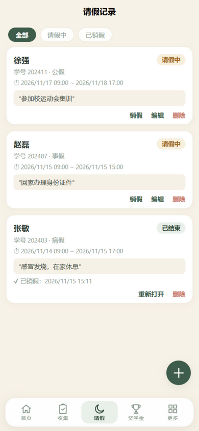
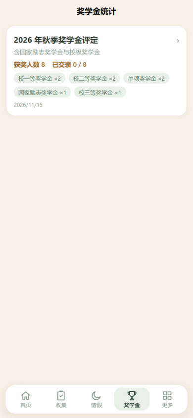
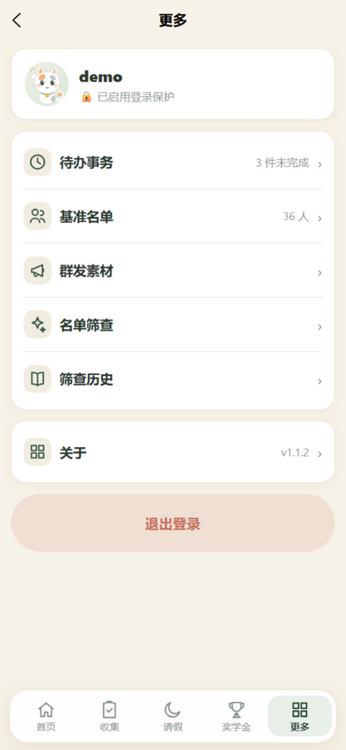

<div align="center">

# 喵班 · 班级成员管理系统 — 移动端

**奶油治愈系手绘猫风的班级事务助手** · uni-app + Vue3 + Vite

一套代码 → **H5 网页** / **Android APP**（web-view 壳）· 与桌面端共用同一个后端 · 同源 Cookie 会话互通

[功能总览](#-功能总览) · [界面预览](#-界面预览) · [快速开始](#-快速开始) · [构建与部署](#-构建与部署) · [架构设计](docs/ARCHITECTURE.md) · [API 文档](docs/API.md) · [贡献指南](CONTRIBUTING.md) · [更新日志](CHANGELOG.md)

   

</div>

---

## ✨ 项目简介

「喵班」是面向大学班级（班长视角）的轻量级班级事务管理**移动端**：收资料、记请假、管奖学金、盯待办，掌上完成。

- **一套代码，两种形态**：同一工程编译出 H5 网页（部署在服务器 `/m/` 子路径）和 Android APP（web-view 壳加载服务器 H5）——**H5 更新即 APP 更新，无需重新打包 APK**
- **与桌面端零耦合**：复用桌面版同一个 Spring Boot 后端（`/api`），同源 Cookie 登录，**与桌面版会话互通**（桌面登录过，移动端 7 天内免重复登录）
- **有性格的 UI**：奶油底 × 深林绿的治愈系配色，配自研手绘三花猫插画家族与 30+ 线性图标库，拒绝 emoji 凑数

> 桌面端 + 后端（Spring Boot 3.2 / Java / MySQL）：[mimo_Class_Management_System](https://github.com/Captainlidong/mimo_Class_Management_System)

## 📱 界面预览

> 以下截图取自 390×844 手机视口下的真实渲染（演示数据），登录后一路可见。

| 登录 | 欢迎过场 | 首页 |
| :---: | :---: | :---: |
|  |  |  |

| 资料收集与分发 | 任务详情 | 待办事务 |
| :---: | :---: | :---: |
|  |  |  |

| 请假记录 | 奖学金统计 | 更多 |
| :---: | :---: | :---: |
|  |  |  |

<p align="right"><sub>手绘三花猫插画 · 奶油底 × 深林绿主题 · 全站线性图标</sub></p>


## 🐱 功能总览

| 模块 | 能力 |
|---|---|
| 🔐 登录 | 账号 + 密码 + 图形验证码；`CMS_SESSION` Cookie 7 天滑动免登录 |
| 🏠 首页 | 收集任务总进度环、请假动态、待办提醒卡（前 3 条 + 逾期/今日到期标记）、登录欢迎过场动画 |
| 📥 资料收集与分发 | 任务列表 / 详情 / 新建；条目状态切换、行内备注、一键标记全部、批量移除、复制未交名单、导出 xlsx/csv |
| 📝 请假记录 | 筛选、登记、编辑、销假/重开、删除、统计 |
| 🏅 奖学金统计 | 批次列表 / 详情、获奖人交表状态切换 |
| ⏰ 待办事务 | 列表 / 新建 / 编辑 / 删除；截止日期、逾期与今日到期自动标记 |
| 👥 基准名单 | 班级名单查看（姓名 / 学号） |
| 🔍 名单筛查 + 历史 | 名单比对（截图 OCR 识别由后端完成）、筛查历史记录 |
| 📢 群发素材 | 列表 / 详情、**拍照上传附件**、标记已发 / 未发 |

## 🧱 技术栈与自研 UI 资产

| 层 | 技术 |
|---|---|
| 框架 | uni-app（**Vue 3.4 + Vite 5.2**，npm/Vite 工程形态，非 HBuilderX 原生工程） |
| 状态管理 | pinia 2.1 |
| 样式 | sass + `uni.scss` 设计令牌（奶油 × 深林绿主题） |
| 图标 | 自研 [AppIcon](src/components/AppIcon.vue) 线性图标库（30+ SVG，单 path、stroke 1.8、currentColor） |
| 插画 | 自研手绘三花猫 SVG 组件家族（CatSitting / CatWave / CatSleep / CatWork + SpeechBubble） |
| APP 形态 | `APP-PLUS` 构建 + HBuilderX 云打包；web-view 壳加载服务器 H5 |

## 🚀 快速开始

### 环境要求

- Node.js ≥ 18
- 一个可用的后端服务（见[后端仓库](https://github.com/Captainlidong/mimo_Class_Management_System)，默认跑在 `8080` 端口）

### 1. 安装依赖并启动

```bash
npm install        # 国内网络可加 --registry=https://registry.npmmirror.com
npm run dev:h5
```

浏览器访问 <http://127.0.0.1:5174/m/>（建议 F12 切换到 390×844 手机视口，体验最佳）。

开发模式下 `/api` 请求自动代理到 `127.0.0.1:8080`（见 `vite.config.js`）。

### 2. 配置生产服务器地址（仅打 APP 包需要）

```bash
cp .env.example .env.local    # 填入你自己的服务器地址，该文件已被 gitignore
```

纯 H5 开发与部署**不需要**这一步（H5 与后端同源，走相对路径 `/api`）。

## 📦 构建与部署

### 构建 H5

```bash
npm run build:h5     # 产物：dist/build/h5/（资源路径带 /m/ 前缀）
```

### 部署到服务器（Nginx）

把 `dist/build/h5/` 里的内容上传到服务器静态目录，Nginx 增加：

```nginx
location /m/ {
    alias /www/wwwroot/your-site/mobile/;
    index index.html;
    try_files $uri $uri/ /m/index.html;   # SPA 回退
}

# /api 反代到 Spring Boot（与 H5 同域 → 同源 Cookie，无 CORS 问题）
# location /api/ { proxy_pass http://127.0.0.1:8080; ... }
```

### 构建 Android APP（云打包）

1. `.env.local` 填入你的服务器地址
2. `npm run build:app`
3. 用 HBuilderX 打开本工程 → 发行 → 原生 App-云打包（包名、证书自选）
4. `manifest.json` 中的 `usesCleartextTraffic: true` 是为 HTTP + 纯 IP 服务器准备的；你的服务器上了 HTTPS 后可移除

> APP 壳的本质：`pages/index/index.vue` 的 `APP-PLUS` 条件编译分支用 web-view 加载 `${VITE_PROD_SERVER}/m/`，返回键映射网页 history 后退。**服务器 H5 更新后 APP 下次打开即生效。**

## 📁 目录结构

```
src/
├── api/
│   ├── request.js        # uni.request 统一封装：401 拦截→跳登录、code===0 判定、上传、下载
│   └── index.js          # 全部后端接口清单（按模块分组，见 docs/API.md）
├── config/
│   └── server.js         # 生产服务器地址（VITE_PROD_SERVER 环境变量）
├── components/
│   ├── AppIcon.vue       # 线性图标库（30+，单 path，currentColor）
│   ├── EmptyState.vue    # 空态组件（猫插画）
│   ├── ProgressRing.vue  # 环形进度
│   ├── TabBar.vue        # 自绘底部导航（CSS 实现，无 PNG 图标）
│   └── cats/             # 手绘三花猫插画家族 + 语气泡
├── pages/
│   ├── index/            # 首页（汇总卡 + 欢迎过场）
│   ├── login/            # 登录（验证码 + 按钮三态）
│   ├── collection/       # 资料收集与分发：list / detail / create
│   ├── leave/            # 请假：list / edit
│   ├── scholarship/      # 奖学金：list / detail
│   └── more/             # 名单 / 待办 / 素材 / 筛查 / 历史 / 更多
├── stores/auth.js        # 登录态（Pinia）
├── styles/theme.scss     # 公共样式 + 动画 keyframes
├── uni.scss              # 设计令牌（色板）
└── utils/format.js       # 问候语 / 日期格式化
```

## 🎨 设计语言「喵班」

### 色板（`uni.scss` 设计令牌）

| Token | 值 | 用途 |
|---|---|---|
| `$cream-bg` | `#F7F2E7` | 全局奶油底 |
| `$primary` | `#3E5C4B` | 深林绿主色 |
| `$sage-card` | `#DCE8DC` | 鼠尾草卡片 |
| `$ink` / `$ink-light` | `#2F3B33` / `#8A9A8E` | 正文 / 辅助文字 |
| `$matcha` | `#8FB79B` | 抹茶绿（成功/进行中） |
| `$peach` / `$butter` / `$taro` | `#E8B4A0` / `#E3CFA0` / `#CBDACB` | 功能点缀色 |
| `$berry` | `#C96F5E` | 警示 / 逾期 |
| `$line` | `#E8E2D4` | 奶油描边 |

> 规范：**页面内禁止硬编码色值**，一律引用 `uni.scss` 令牌（详见 [CONTRIBUTING.md](CONTRIBUTING.md)）。

### 手绘猫插画家族

| 组件 | 出场场景 |
|---|---|
| `CatSitting` | 登录页主视觉、首页彩蛋 |
| `CatWave` | 登录欢迎过场、用户头像 |
| `CatSleep` | 空态（没有数据时打盹） |
| `CatWork` | 待办事务页 |
| `SpeechBubble` | 语气泡（欢迎语、随机吐槽） |

## 🗺 Roadmap

- [ ] 深色模式（令牌体系已就绪）
- [ ] 长期任务 / 自定义分组页面（对齐桌面端）
- [ ] 统一网络异常页（猫 + 重试）
- [ ] 微信小程序形态（uni-app 直接编译产出）
- [ ] 首页骨架屏

## 📄 License

[MIT](LICENSE) © 2026 Captainlidong
